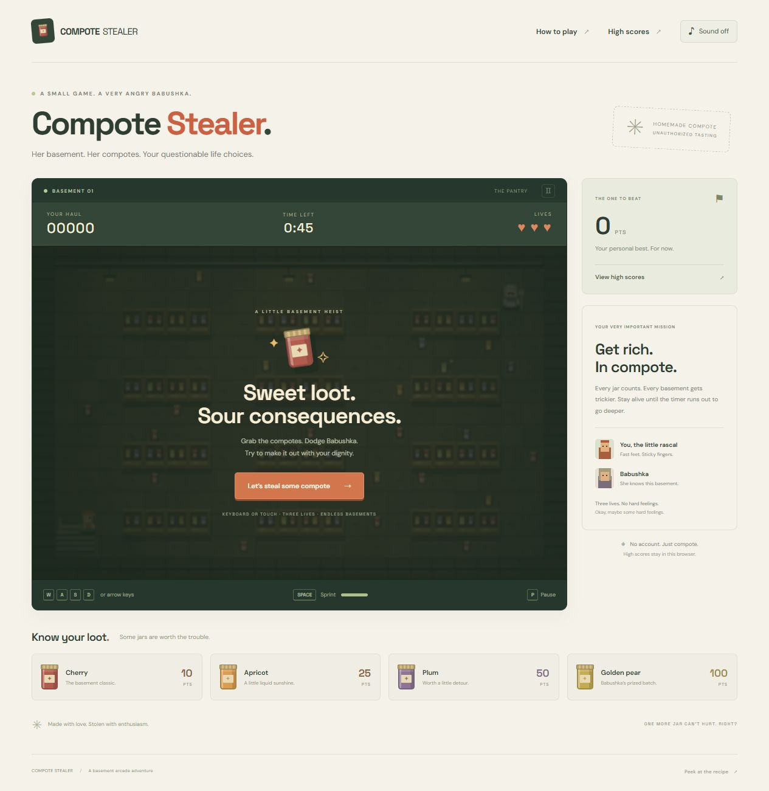

# Compote Stealer

A little basement mischief. Play a young rascal stealing jars of compote while Babushka chases you through an increasingly difficult series of basements.



## Play

- **Move:** WASD or arrow keys. Touch controls appear on touch devices.
- **Sprint:** hold Space or the Sprint button; release to refill your stamina.
- **Pause:** P, Escape, or the pause button. Leaving the tab pauses the chase automatically.
- **Collect:** walk over jars. Cherry earns **10**, apricot **25**, plum **50**, and golden pear **100 points**.
- **Survive:** the first basement lasts **45 seconds**. When the timer ends, you earn **100 × basement number** points and automatically move to the next level. Every two levels the timer becomes two seconds shorter, down to 30 seconds. Babushka gradually gets faster. Five layouts cycle for endless play.
- **Clear the room:** grab all 22 jars for a **250-point bonus** and a fresh batch.
- **Three lives:** each catch costs one life. A brief grace period lets you recover. Your score carries across lives and levels.
- **Save:** enter a name when a run ends and press **Save score**. You can also pause and choose **End run & save score**. The top ten scores are saved in your browser’s local storage.

The leaderboard is local to each browser and device. It is not a shared online leaderboard. Clearing site data removes saved scores.

## Run locally

Requires Node.js 20 or newer. No third-party packages or install step are needed.

```sh
npm run dev
```

Open `http://127.0.0.1:5173`. To test and create the production build:

```sh
npm test
npm run build
node scripts/serve.mjs --dist
```

## Deploy on Netlify

1. In Netlify, choose **Add new project → Import an existing project** and connect this GitHub repository.
2. Select the `main` branch. The included `netlify.toml` configures **build command: `npm run build`** and **publish directory: `dist`**.
3. Deploy. Future pushes to the connected branch trigger a new deployment.
4. Add the resulting Netlify URL to a game/project card on your portfolio.

For manual deployment, run `npm run build` and drag the generated `dist` folder into Netlify’s manual deploy area. This is a fully static game: no backend, API keys, database, or environment variables are required.

Netlify’s official [file-based configuration guide](https://docs.netlify.com/build/configure-builds/file-based-configuration/) explains the build and publish settings used here.

The game also works from a subfolder if you later host it directly on your portfolio. All application asset paths are relative. DM Sans and Space Grotesk are optional Google Fonts with local system fallbacks; gameplay and artwork do not rely on external services.

## Project structure

```text
index.html           Accessible page, game HUD and start screen
style.css            Responsive layout, touch controls and CSS jar artwork
src/engine.js        Game rules, collision, pathfinding and score persistence
src/renderer.js      Original Canvas pixel artwork
src/main.js          Browser input, dialogs, audio and frame loop
scripts/             Static dev server and production build
tests/               Game behavior and persistence tests
netlify.toml         Netlify build and hosting configuration
```

Artwork is drawn with Canvas and CSS. Sound effects are generated with Web Audio and default to off. Game rules and rendering are separate modules so the gameplay can be extended without changing the page.
